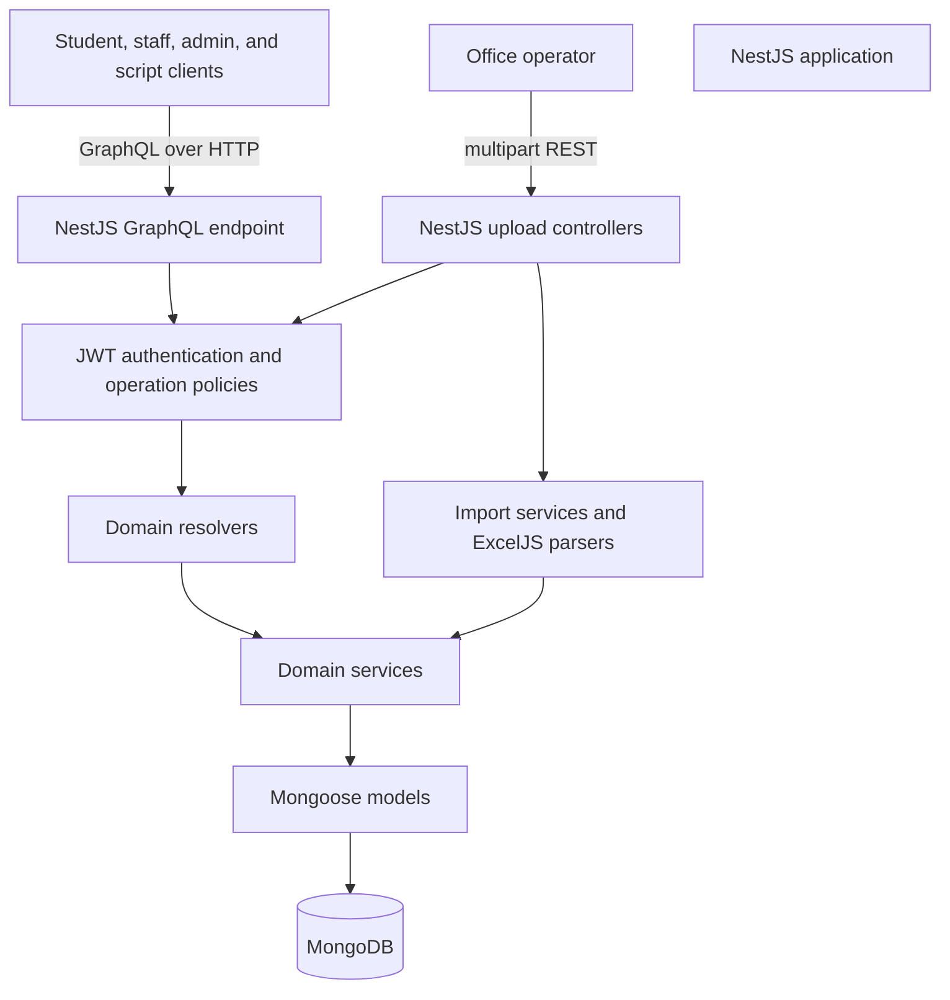

# System Workflow: NestJS

## Purpose and implementation status

This document describes how the workflows in [SYSTEM-WORKFLOW.md](./SYSTEM-WORKFLOW.md) map to NestJS. The source workflow describes an Express, Apollo, Mongoose, and MongoDB application. This repository is a NestJS starter and does not yet implement those domain workflows.

The current NestJS code provides:

- `GET /`, handled by `AppController` and `AppService`.
- A code-first GraphQL endpoint at `/graphql`, currently with a `hello` query.
- A Mongoose connection configured with `MONGODB_URI` and optional `MONGODB_DATABASE`.

The NestJS request flows below are the target design for migrating the source system. Authentication, role policies, domain resolvers/services/models, and spreadsheet upload routes must be added before those flows are available.

## Target architecture



GraphQL remains the API for interactive application operations. Spreadsheet ingestion remains REST because it uploads multipart files. Both transports use Nest modules, dependency injection, and domain services to reach MongoDB through Mongoose.

## Application startup

1. `src/main.ts` creates the Nest application from `AppModule`.
2. `ConfigModule` loads environment configuration.
3. `MongooseModule` connects using required `MONGODB_URI`; `MONGODB_DATABASE` defaults to `examination_db`.
4. `GraphQLModule` configures the Apollo driver and builds the code-first schema from registered resolvers.
5. Nest starts listening on `PORT`, or `3000` when unset.

The current module requires MongoDB to connect during startup and logs connection, disconnection, and connection-error events. The starter does not yet configure authentication, REST upload routes, global validation, or health/readiness endpoints.

## GraphQL request workflow

The NestJS equivalent of the legacy GraphQL flow is:

```text
Client
  -> POST /graphql
  -> NestJS GraphQL / Apollo driver
  -> request context and JWT authentication
  -> guards and operation-specific role/policy checks
  -> domain resolver
  -> domain service
  -> Mongoose model
  -> MongoDB
  -> resolver result
  -> GraphQL response
```

1. **Client sends an operation.** The client posts a GraphQL query or mutation and variables to `/graphql`. Operations that require identity include a bearer access token.
2. **NestJS/Apollo dispatches the operation.** Nest routes the request to the resolver for the requested schema field.
3. **The request identity is established.** An authentication strategy verifies the token and exposes the caller's identity and relevant role claims to the GraphQL request context.
4. **Access is authorized.** Guards and policy metadata enforce access for each operation. Apply ownership and assignment checks in the domain service as well, such as limiting a student to their own allocations or staff to assigned rooms/sessions.
5. **The resolver delegates.** A thin resolver validates/maps GraphQL inputs and calls the owning domain service; business rules should not be embedded in resolvers.
6. **The service accesses MongoDB.** The service validates domain rules and uses its module's Mongoose model/repository to read or persist documents.
7. **The result returns to the client.** The resolver returns the typed result and Apollo serializes the GraphQL response.

The legacy implementation leaves decoded token context undefined when the bearer token is absent or invalid, then relies on GraphQL Shield rules configured for particular operations. In the NestJS migration, make public and protected operations explicit: protected operations must reject missing or invalid credentials, and role/resource authorization must be applied consistently. This is a security-sensitive behavior change to verify against current clients and operation policies.

### Domain coverage to migrate

Organize the system's GraphQL operations around these domains:

- **Authentication and administration:** sign-in and administrator/sub-administrator operations, with approved identity verification and explicit authorization.
- **Exams and students:** exam papers, student allocations, registration/unregistration, and student allocation lookup.
- **Rooms and invigilation:** room data, schedules, assignments, and staff access to their assigned sessions.
- **Staff, attendance, and payments:** support personnel, signatures, attendant sheets, signed-record search, and payment configuration/operations.
- **Script collection and scantrons:** collection/delivery tracking, Obuasi script records, and scantron submission/marking/collection.
- **Supporting records:** examiners, missing-allocation/course reports, and exams-support personnel on timetables.

Keep the existing client schema and response behavior during migration where required. Inventory each query/mutation, its inputs, return shape, permission rule, and data effects before replacing it.

## Spreadsheet upload workflow (REST)

Uploads continue to use `multipart/form-data` with a file field named `file`; they do not pass through GraphQL.

```text
Office operator
  -> POST /api/upload-data/{type} (multipart file)
  -> NestJS upload controller
  -> authentication and operator authorization
  -> upload limits and file validation
  -> import service
  -> ExcelJS parser and domain validation
  -> domain/collection service
  -> Mongoose model
  -> MongoDB
  -> import response or explicit error
```

1. **Operator uploads a workbook.** The operator sends a multipart request to the matching route and supplies the workbook in the `file` field.
2. **NestJS receives and protects the upload.** A Nest controller and upload interceptor receive the file. Guards authenticate the caller and authorize the import type; enforce file size and accepted format before parsing.
3. **The import service parses the workbook.** The service uses the appropriate ExcelJS parser to map workbook rows into domain records and validate them.
4. **Domain services persist the data.** Only after validation, invoke the corresponding domain/collection service to apply the import's defined persistence policy.
5. **The API reports the outcome.** Return the established response contract or an explicit failure. Where the contract permits, include row-level validation details; do not report success for a partial or failed import.

The legacy `/api/upload-data/room` workflow deletes existing room records and inserts the parsed rooms. Other imports differ: some append without clearing existing records. Preserve each import's intended behavior during migration; do not assume an upload is safe to repeat. Prefer validating the complete workbook before writes and make destructive replacement scope explicit.

### Upload endpoint mapping

Keep the legacy route paths during migration unless clients are deliberately moved to a versioned API.

| Legacy route | NestJS controller/domain |
|---|---|
| `/api/upload-data/room` | Imports controller -> rooms service |
| `/api/upload-data/exams-support` | Imports controller -> staff/exams-support service |
| `/api/upload-data/teaching-assistants` | Imports controller -> teaching-assistant/staff service |
| `/api/upload-data/timetable` | Imports controller -> exams/papers service |
| `/api/upload-data/invigilation-schedule` | Imports controller -> invigilation service |
| `/api/upload-data/attendant-sheets` | Imports controller -> attendance service |
| `/api/upload-data/missing-allocations` | Imports controller -> student allocation/report service |
| `/api/upload-data/script-collection-data` | Imports controller -> script-collection service |
| `/api/upload-data/obuasi` | Imports controller -> Obuasi script service |

For imports that exceed a normal request's processing time, a queue/worker and import-status endpoint can be introduced as a later step. The current application has no queue, worker, import records, or upload controller.

## NestJS module boundaries

Keep transport adapters thin and put business logic in injectable services. A migration can organize the code as follows:

| NestJS module | Responsibility |
|---|---|
| `auth` | Identity verification, JWT strategy, request-user context, and shared policy primitives |
| `administrators` | Administrator/sub-administrator management and access-controlled operations |
| `students` | Student identity, registration, and allocation access |
| `exams` | Papers, timetable data, exam sessions, and allocations |
| `rooms` | Room records and room imports |
| `invigilation` | Schedules and personnel assignments |
| `staff` | Exams support, teaching assistants, and staff records |
| `attendance` | Attendant sheets, signatures, and signed-record operations |
| `payments` | Payment configuration and payment-related operations |
| `script-collection` | Script collection, delivery, and Obuasi script workflows |
| `scantrons` | Scantron submission, marking, and collection |
| `imports` | REST upload controllers, ExcelJS parsing orchestration, validation, and results |

Each domain module owns its resolver or controller, service, inputs/DTOs, Mongoose schema registration, and focused tests. Cross-domain operations should call another module's service rather than directly accessing its models.

## Mapping from the source workflow

| Source system component | NestJS equivalent |
|---|---|
| Express server and middleware | Nest application bootstrap, middleware, guards, pipes, filters, and interceptors |
| Apollo server mounted at `/graphql` | Nest `GraphQLModule` with the Apollo driver |
| GraphQL Shield permissions | Guards and explicit policy metadata; resource ownership checks in services |
| GraphQL schema and resolver composition | Code-first GraphQL types and domain resolvers |
| Resolver/application logic | Injectable domain services |
| Express `/api/upload-data` routes | Nest REST controllers with upload interceptors |
| Upload service and ExcelJS parsers | Imports module orchestration and parser providers |
| Collection services and Mongoose models | Domain services and Mongoose schemas registered by the owning modules |
| Environment-driven MongoDB connection | `ConfigModule` and asynchronous `MongooseModule` configuration |

## Security and data-integrity requirements

- Define and test an operation-by-operation role matrix for students, invigilators, sentinels, administrators, and sub-administrators.
- Protect every administrative, data-changing, and spreadsheet-import operation. Upload routes are a separate authorization surface from GraphQL.
- Verify identity credentials at sign-in; do not treat a predictable identifier alone as proof of identity.
- Minimize JWT claims; configure expiry and rotation/revocation behavior. Never log tokens or sensitive claim values.
- Validate the complete workbook before mutating live collections. Define append, upsert, or replacement semantics per import and make retries safe where possible.
- Avoid logging workbook contents, bank details, signatures, or other unnecessary personal data.
- Test authorized and denied requests, validation failures, persistence behavior, and each import's repeat/replacement semantics.

## Main implementation files

| Concern | Current file |
|---|---|
| Nest application bootstrap | `src/main.ts` |
| GraphQL, configuration, and MongoDB registration | `src/app.module.ts` |
| Root HTTP endpoint | `src/app.controller.ts` |
| Shared starter service | `src/app.service.ts` |
| Starter GraphQL resolver | `src/app.resolver.ts` |
| Legacy GraphQL and upload workflow | `SYSTEM-WORKFLOW.md` |
| Broader architecture and migration recommendations | `SYSTEM-DESIGN.md` |
