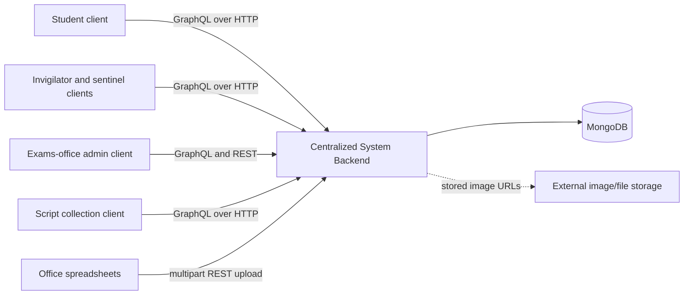
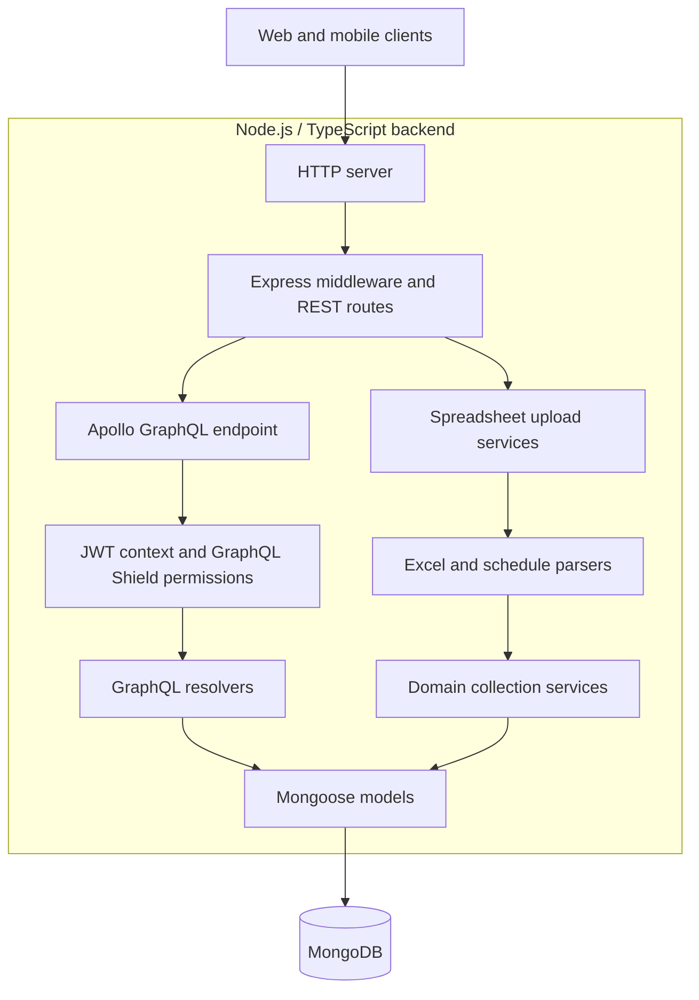
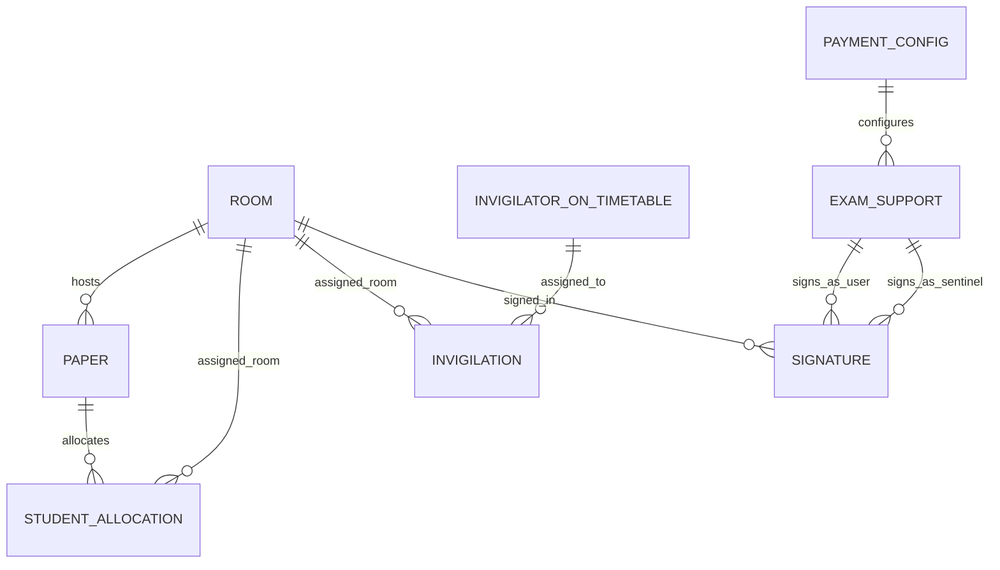
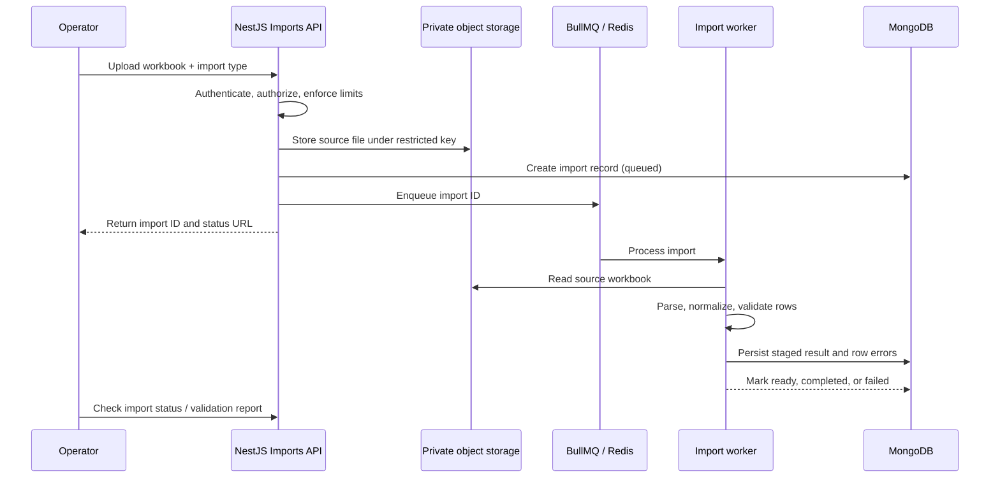
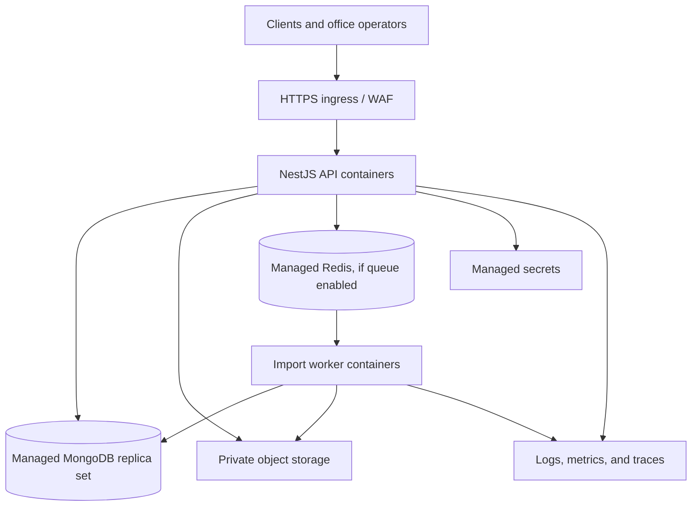

# Centralized Exams Office System — System Design

## 1. Purpose and scope

This document describes the system inferred from the current backend source. It captures the current architecture and data responsibilities, then identifies design recommendations separately. It is not a claim that the recommended controls or components already exist.

The backend supports exams-office workflows for the College of Engineering, KNUST, including exam schedules and student allocations, room and invigilation data, support staff and payments, attendance/signatures, script collection, and scantron tracking.

## 2. System context



The repository does not include the client applications, MongoDB deployment, or file-storage service. The presence of image URLs in models indicates that at least some uploaded images are stored outside MongoDB, but this backend does not establish the storage provider or its lifecycle.

## 3. Architecture



### Runtime components

| Component | Current responsibility |
|---|---|
| Express | HTTP middleware, CORS allowlist, compression, request logging, multipart file upload, and `/api` routes |
| Apollo Server | GraphQL endpoint at `/graphql`; combines the schema, resolvers, and GraphQL Shield permissions |
| JWT context | Reads a bearer token, verifies it using the configured JWT secret, and makes decoded claims available to resolvers |
| GraphQL resolvers | Implements sign-in, exam/student data, staff and payment operations, signatures, script collection, and scantron operations |
| Upload services and parsers | Accept spreadsheet files, parse workflow-specific data, and write parsed records |
| Mongoose models | Map domain records to MongoDB collections |
| Configuration | Reads port, host, MongoDB URI, JWT secret, and optional TLS key/certificate from environment variables |

The application starts by connecting to MongoDB, then creates the HTTP or HTTPS server and attaches Apollo. HTTP and HTTPS are selected from configuration; when TLS is enabled, the configured SSL port is used.

## 4. Main functional domains

1. **Exam setup and student allocation**
   - Exam papers include course, exam type, semester, session, date, time, rooms, and optional examiners/class details.
   - Student allocations associate an index number and student name with a paper and optionally an allocated room.
   - Students can sign in using an index number and retrieve their allocations.

2. **Rooms and invigilation**
   - Rooms include location/capacity data and a QR-code image URL.
   - Invigilation schedule records connect a date/session/time and room to assigned invigilators.
   - Invigilator and sentinel identities are represented through support/personnel records and token claims.

3. **Support staff, attendance, and payments**
   - Exam-support records represent personnel, categories, payment status, hours, and optional payment configuration and bank details.
   - Signature records associate the signing person, room, session, timestamp, duration, and image URL.
   - Payment configuration records store rate/tax settings.

4. **Script collection and scantron tracking**
   - Script collection records track course/exam metadata, collection and delivery details, counts, status, and image references.
   - Scantron records track submission, marking, and collection stages and their associated counts and signatures.
   - Separate Obuasi script records and operations are also present.

5. **Administrative operations**
   - Admin operations include administrator management and sign-in, student registration and unregistration, staff/payment management, and signed-record search.
   - Additional records support missing-course reports and exam-support personnel on timetables.

## 5. Data model overview

The following is a conceptual view of the principal relationships expressed in the Mongoose models. It is not a complete ER diagram; some links in the code are stored as plain strings rather than database references.



Other collections include administrators, examiners, attendant sheets, missing-course reports, script users, script collection records, Obuasi script records, and scantrons. Confirm actual collection names and deployed indexes against the production database before running migrations or data transformations.

## 6. Key request and data flows

### Authenticated GraphQL operation

1. A client submits a GraphQL operation to `/graphql`, optionally with a bearer JWT.
2. Apollo verifies the token using `JWT_ACCESS_SECRET`; missing or invalid tokens result in an undefined context rather than an authentication error at this stage.
3. GraphQL Shield evaluates rules for configured operations.
4. A resolver validates/uses the relevant claims, queries or updates Mongoose models, and returns the result.
5. Apollo serializes the GraphQL response.

### Spreadsheet import

1. An operator sends a multipart request containing a file to a route under `/api/upload-data`.
2. The corresponding upload service invokes the domain parser.
3. Parsed records are passed to collection services and persisted in MongoDB.
4. The route returns a response through the request decorator.

The upload endpoint routes and GraphQL permission rules are separate surfaces. The current source does not show authentication middleware on the upload routes, so access control for these routes must be verified and explicitly designed.

## 7. Identity and access model

The code recognizes student, invigilator, sentinel, administrator, and sub-administrator identities. JWT claims vary by identity type; GraphQL permissions use claims such as index number, passcode, email, NSS number, and category.

The permission map is operation-specific, not a global policy declaration for every schema field. As a result, a documented access matrix should be maintained and tested against every query and mutation. In particular:

- Require authentication and role authorization on all administrative and data-changing operations.
- Protect spreadsheet imports with operator authorization and audit logging.
- Verify identity credentials at sign-in; avoid treating possession of a predictable identifier alone as proof of identity.
- Minimize sensitive claims in JWTs, set expiration/rotation policy, and never log tokens or sensitive claim values.

## 8. Deployment and configuration

The backend is configured through environment variables, including `PORT`, `HOST`, `MONGODB_URI`, `JWT_ACCESS_SECRET`, and optional TLS key/certificate settings. Local development uses Node.js 16 and Yarn 1 according to the project manifest and README.

The repository does not fully specify production topology, scaling, backup/restore, monitoring, network boundaries, or file storage. A production deployment design should define:

- TLS termination and trusted proxy behavior.
- Private network access from the application to MongoDB.
- Secret storage and rotation outside source control.
- MongoDB backup, restore drills, and retention.
- Application health/readiness checks and graceful shutdown.
- Centralized structured logs, metrics, and alerting.
- File storage access policies, retention, and deletion behavior.
- Separate development, staging, and production configuration.

## 9. Quality attributes and design constraints

### Security and privacy

Student identifiers, staff details, bank account data, and signature images are sensitive. Apply least privilege, transport encryption, data minimization, access auditing, retention limits, and restricted operational access. Remove credentials from repository documentation and rotate any credentials that have been committed.

### Data integrity

Spreadsheet imports can create or replace operational records. Validate the complete file before writing, report row-level failures, and use idempotent upserts or a staged import/confirmation flow where repeated imports must not duplicate records. For multi-collection updates, define rollback or compensation behavior.

### Availability and recovery

MongoDB connectivity is required for application startup and normal operation. Define service-level targets, database backup objectives, recovery-point and recovery-time objectives, and an operator procedure for failed imports.

### Observability

Use correlation IDs and structured logs for requests and imports. Record actor, operation, affected record counts, outcome, and failure reason while excluding secrets, credentials, and unnecessary personal data.

## 10. Current-state gaps and recommended next steps

These are design follow-ups based on the visible repository, not statements that the entire deployed system lacks these capabilities:

1. **Document and test authorization:** build an operation-by-operation role matrix; enforce it for both GraphQL and REST; add tests for allowed and denied access.
2. **Secure file imports:** authenticate and authorize uploads, enforce file type/size limits, validate rows and domain constraints, and provide auditable import results.
3. **Improve import reliability:** parse and validate before mutating live data; make retries safe; preserve a source file/import summary where policy permits; add rollback or recovery guidance.
4. **Protect secrets and personal data:** remove committed credentials, rotate exposed values, use a managed secret store, and avoid logging sensitive data.
5. **Establish operational readiness:** add health/readiness endpoints, graceful shutdown, structured logs, metrics, backup/restore documentation, and environment-specific deployment guidance.
6. **Create a test baseline:** the package manifest currently exposes build and lint scripts but no test script. Add focused tests for authorization, allocation logic, parsers, and import behavior before changing these workflows.
7. **Formalize schema evolution:** document MongoDB indexes and uniqueness expectations, and introduce a reviewed migration/data-change process.

## 11. Assumptions and questions to confirm

- The backend is used by separate web/mobile clients, inferred from the identity types and README; client boundaries and client ownership are not included here.
- The production MongoDB topology, deployment platform, expected load, availability targets, and data retention rules were not available in the repository.
- File/image storage appears external because records store image URLs; provider, access control, and lifecycle need confirmation.
- Confirm whether spreadsheets are authoritative source data and what the expected behavior is when an import is partial, repeated, or invalid.
- Confirm the intended role permissions and whether legacy endpoints or clients depend on current response shapes.

## 12. Proposed target design: NestJS and supporting stack

This section is a concrete recommended architecture for a replacement or incremental modernization. It is not the current implementation. The design keeps MongoDB and GraphQL, adds NestJS module boundaries, and uses REST for bulk file upload.

### Recommended technology stack

| Area | Proposed technology | Why |
|---|---|---|
| Runtime | Node.js current LTS; TypeScript with strict compiler settings | Supported runtime and consistent type checking |
| Application framework | NestJS with Express adapter | Modules, dependency injection, guards, pipes, interceptors, and testable service boundaries |
| Main API | NestJS GraphQL, Apollo driver, code-first schema | Keeps the client-facing GraphQL contract while using Nest authorization and dependency injection |
| Bulk upload API | NestJS REST controllers using multipart upload | Better fit for workbooks, file limits, upload status, and row-level error responses |
| Database | MongoDB replica set, Mongoose through `@nestjs/mongoose` | Preserves current document model and supports transactions where required |
| Authentication | Passport JWT strategy, short-lived access JWTs, rotating refresh-token strategy for staff/admin clients | Centralizes identity validation and gives sessions a revocation path; exact student sign-in proof needs product approval |
| Authorization | Nest guards and explicit role/policy metadata, with resource ownership checks in domain services | Makes API access rules explicit for both GraphQL and REST |
| Request validation | `class-validator` and `class-transformer` DTOs, with schema-level Mongo validation where practical | Consistent validation at the API boundary and persisted-data constraints |
| Import processing | ExcelJS parser, Redis + BullMQ worker for large or long-running imports | Keeps requests responsive and supports retries, progress, and failure reporting |
| File storage | Private S3-compatible object storage with short-lived signed URLs | Avoids storing image/file bytes in MongoDB and supports restricted access and lifecycle policies |
| Logging and monitoring | Pino structured logs, OpenTelemetry traces/metrics, provider-managed dashboards and alerts | Correlates API requests, imports, and database operations |
| Testing | Jest, Nest testing utilities, Supertest, and MongoDB test replica set | Covers unit, API authorization, and database behavior |
| Packaging and delivery | Docker, GitHub Actions CI, deployment to a managed container service (e.g. AWS ECS Fargate) | Repeatable builds and a low-operations deployment target |
| Secrets | Cloud secret manager; separate secrets per environment | Keeps credentials and signing keys out of source control and build artifacts |

Use the organization’s existing cloud provider if one is established. The AWS services named here are an example cohesive deployment choice, not a requirement to migrate cloud providers. Avoid adding Redis, a queue, or a cache until import volume or latency needs justify the operational cost; the queue is recommended for imports that can take longer than a normal HTTP request.

### NestJS application structure

```text
src/
  app.module.ts
  main.ts
  common/
    auth/                 # JWT strategy, guards, current-user decorator
    database/             # Mongoose connection and health checks
    filters/              # HTTP and GraphQL exception mapping
    logging/              # request context and structured logging
    pagination/
  modules/
    auth/
    students/
    exams/                # papers, sessions, student allocations
    rooms/
    invigilation/
    staff/
    attendance/           # attendant sheets and signed records
    payments/
    script-collection/
    scantrons/
    imports/
    audit/
  workers/
    import.worker.ts
```

Each domain module owns its resolver or controller, application service, input/output types, Mongoose schema, and module tests. Resolvers/controllers should remain thin. Domain services own business rules and persistence coordination; they should not depend on other modules' Mongoose models directly when a module-level service can provide the operation.

`main.ts` should configure the global validation pipe, safe exception handling, request IDs, CORS allowlist, security headers, upload limits, and shutdown hooks. GraphQL Playground/introspection should be limited to approved environments or protected operational access. The application should expose separate liveness and readiness checks; readiness should verify required dependencies such as MongoDB.

### API design

- Keep GraphQL at `/graphql` for interactive application queries and mutations.
- Keep health checks and spreadsheet ingestion as REST routes, for example `/api/v1/imports` and `/api/v1/imports/:id`.
- Use GraphQL input types for mutation inputs and return typed results rather than ambiguous strings.
- Use cursor or bounded page-based pagination for potentially large lists; cap page sizes and batch related MongoDB reads to avoid N+1 queries.
- Publish a versioning/deprecation policy. Avoid breaking existing clients during migration; add a compatibility layer or preserve existing fields until clients have moved.
- Apply authentication and authorization consistently to GraphQL fields and REST routes. A successful JWT check alone is not sufficient for record-level access.

### Identity and authorization

Represent users with a stable internal identity and explicit role/permissions rather than relying on loosely shaped JWT claims. An access token should contain only the subject, issued/expiry times, token identifier, and minimal role information. Resolve current role and account state where revocation or role changes must take effect quickly.

Suggested policy:

| Actor | Example allowed scope |
|---|---|
| Student | Read own allocations and submit permitted student reports |
| Invigilator | Read own assignment and submit permitted attendance data |
| Sentinel | Access assigned rooms/sessions and record signatures |
| Admin | Manage exam operations, imports, staff, and authorized reports |
| Sub-admin | Explicitly configured subset of administrative operations |

Treat this as a starting point only. Product owners should approve the actual role/action matrix. Implement both role checks and ownership/scope checks in services, and test denied access for every sensitive operation. Do not use shared hard-coded credentials or accept an identifier-only sign-in without a separately approved verification mechanism.

### MongoDB collections and integrity

Use one collection per independently managed domain entity. Proposed core collections:

| Collection | Key relationships and notes |
|---|---|
| `users` | Internal identity, status, role references; avoid separate uncoordinated auth identities for the same person |
| `academic_periods` | Academic year, semester, and exam session definitions |
| `papers` | Course and exam metadata; references period and rooms |
| `student_allocations` | Student identity/index, paper, optional allocated room |
| `rooms` | Location, capacity, QR image object key |
| `staff` | Staff identity/category and minimum necessary payment details |
| `invigilations` | Period, date/time, room, and assigned staff |
| `attendance_records` | Actor, session/room, timestamps and private signature object key |
| `payment_configs` | Effective-dated payment rates |
| `script_collections`, `obuasi_scripts` | Collection workflow and counts |
| `scantrons` | Submission, marking, and collection workflow |
| `imports` | Import actor, type, status, counts, validation summary, timestamps |
| `audit_events` | Actor, action, target, request ID, result, timestamp |

Prefer references for entities updated or queried independently (papers, rooms, users, staff). Embed small, bounded snapshots only when historical correctness requires it—for example, a display-name snapshot on a signed attendance record. Keep the referenced identity as the source of current authorization, and define how snapshots are corrected.

Create indexes from confirmed query patterns. Likely candidates include unique `{academicPeriodId, courseCode, class, examType}` for papers where business rules allow, `{academicPeriodId, studentId, paperId}` for allocations, and compound indexes for signatures and schedules by period/date/room. Confirm existing duplicates and desired uniqueness before creating unique indexes. Add TTL indexes only for data with an approved retention policy.

Use transactions for workflows that must update multiple collections atomically, after confirming the MongoDB deployment supports transactions. Otherwise design explicit compensating actions. Validate referenced records and domain invariants before writes; Mongoose schema validation alone does not enforce cross-document business rules.

### Spreadsheet import workflow



Never apply a partially parsed workbook as if it were fully successful. Make import behavior explicit per import type: append, upsert, or replace a defined scope. Require confirmation before destructive replacement. Use an idempotency key and stable natural keys to make retries safe. Restrict source-file access and apply retention/deletion policy. Do not log workbook contents or sensitive rows.

### Deployment topology



Run API and worker containers as separate deployable processes from the same codebase. Keep MongoDB, Redis, object storage, and secrets private to the application environment. Terminate TLS at a managed ingress, restrict ingress and egress, and use separate identities/permissions for API and worker processes. Configure rolling deploys, resource limits, autoscaling based on measured demand, and graceful shutdown. Do not cache student or staff data until invalidation and privacy requirements are defined.

### Migration plan

1. **Discovery and contract baseline:** inventory every GraphQL operation, REST upload, role rule, data shape, collection name/index, and active client. Agree on identity verification, import semantics, and retention.
2. **Foundation:** scaffold NestJS, configuration validation, MongoDB connection, health checks, logging, exception mapping, and CI. Add integration tests against a MongoDB replica set.
3. **Compatibility layer:** expose existing GraphQL operation names and response shapes while routing to new modules. Add authorization tests before moving sensitive operations.
4. **Migrate domains incrementally:** start with a bounded read-focused module, then migrate writes and imports. Compare old/new query results on representative data and measure behavior before cutover.
5. **Harden imports and identity:** introduce protected import jobs, auditing, idempotency, and approved sign-in/refresh-token flows.
6. **Cut over and retire legacy code:** use a controlled deployment/rollback window, monitor errors and data consistency, and remove old endpoints only after all clients are verified.

Do not run old and new writers against the same collections without an explicit dual-write/reconciliation strategy. Back up data before index or schema changes, rehearse rollback, and make migrations observable and restartable.

### Decisions required before implementation

- Which client applications and operations must remain backward compatible?
- What credential or verification method is appropriate for each actor, especially students and invigilators?
- For each spreadsheet type, does import append, upsert, or replace a period/scope?
- Which cloud provider and MongoDB deployment are already approved?
- What are the expected workload, availability, recovery, and data-retention targets?
- Who may access bank details and signature images, and for how long must they be retained?
